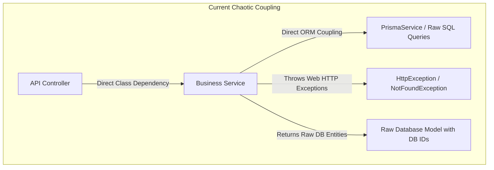
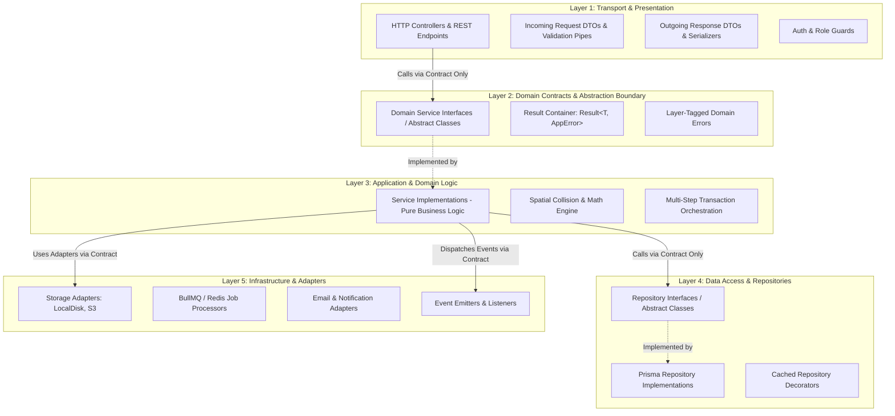

# SpatialOS Backend Layer-by-Layer Architecture & Abstraction Master Plan

**Document ID:** `13_layer_by_layer_abstraction_plan`  
**Target:** `backend/` Codebase  
**Status:** Architecture Proposal & Implementation Runbook  
**Goal:** Transform the backend into a strict 5-layer, contract-abstracted, highly encapsulated enterprise system where every layer performs only its designated role, implementation details remain completely hidden behind interfaces, and errors are immediately traceable to their exact layer and file origin.

---

## 1. Executive Summary & Core Philosophy

### The "Black Box" Contract Principle
In our target architecture, callers **never need to know what happens inside a function, class, or decorator**:
1. **Contract-Driven**: A caller interacts strictly through typed contracts (Abstract Interfaces).
2. **Encapsulation**: The inner workings (SQL joins, caching, third-party libraries, hashing) are isolated inside the implementing layer.
3. **Layer Traceability**: If an operation fails, the returned failure explicitly identifies **which layer** and **which file** originated the error (`TRANSPORT`, `DOMAIN`, `DATA_ACCESS`, `INFRASTRUCTURE`).
4. **Predictable Result Container**: Functions return a structured `Result<T, AppError>` rather than throwing unhandled exceptions across boundaries.

---

## 2. Current State Inventory (Real Codebase Audit)

An exhaustive audit of `backend/src` reveals the following current layout and architectural debt:

### 2.1 File & Directory Inventory
* **Controllers (`src/api/` - 14 files):**
  `actions.controller.ts`, `auth.controller.ts`, `compiler.controller.ts`, `content.controller.ts`, `definitions.controller.ts`, `experiences.controller.ts`, `health.controller.ts`, `instances.controller.ts`, `overview.controller.ts`, `placements.controller.ts`, `placements.controller.spec.ts`, `places.controller.ts`, `settings.controller.ts`, `staff.controller.ts`.
* **Services (`src/logic/` - 14 files + 1 subfolder):**
  `actions.service.ts`, `auth.service.ts`, `compiler.service.ts`, `content.service.ts`, `email.service.ts`, `experiences.service.ts`, `experiences.service.spec.ts`, `garbage-collector.service.ts`, `placements.service.ts`, `places.service.ts`, `seed.service.ts`, `settings.service.ts`, `staff-sync.service.ts`, `staff.service.ts`, `storage/`.
* **AR Services (`src/ar_services/` - 12 files):**
  Mini-App services (`classroom.service.ts`, `coffee-menu.service.ts`, `complaint-box.service.ts`, etc.) with `ar-service.interface.ts`.
* **Repositories (`src/database/repositories/` - only 2 files):**
  Only `auth.repository.ts` and `staff.repository.ts`. **All other services query Prisma directly.**
* **Ghost / Empty Folders (7 directories containing 0 files):**
  `src/actions/`, `src/compiler/`, `src/components/`, `src/content/`, `src/overview/`, `src/prisma/`, `src/services/`.
* **Single-DTO Fragment Folders:**
  `src/experiences/dto/`, `src/places/dto/`.
* **Duplicate Guards & Decorators:**
  `src/auth/guards/` vs `src/common/guards/`, `src/auth/decorators/` vs `src/common/decorators/`.

---

### 2.2 Critical Architectural Debt & Layer-Crossing Flaws



1. **Direct ORM Leakage into Services**:
   In `experiences.service.ts`, `places.service.ts`, and `placements.service.ts`, methods call `this.prisma.experience.findFirst(...)` and `this.prisma.place.create(...)` directly. The business logic is coupled to the database driver.
2. **Web Framework Exceptions Inside Business Logic**:
   Services throw `new NotFoundException('Experience not found')` or `new BadRequestException('...')`. If a service is called by an asynchronous background worker, scheduled job, or event listener, throwing a NestJS HTTP exception is an architectural violation.
3. **Untyped Output Leakage**:
   Raw Prisma objects (containing internal database IDs, foreign key references, and raw relations) are returned directly up through the controller into public HTTP responses.
4. **Tight Concrete Coupling**:
   Controllers inject concrete implementations directly (`constructor(private readonly experiencesService: ExperiencesService)`), preventing dependency inversion and making isolated unit testing cumbersome.

---

## 3. The 5-Layer Encapsulated Clean Architecture Model



---

### Detailed Layer Responsibilities & Rules

| Layer | Component Name | What it Holds | What it is FORBIDDEN to do |
| :--- | :--- | :--- | :--- |
| **Layer 1** | **Transport / Presentation** | REST Controllers, Route mapping, HTTP status codes, Swagger docs, JWT Guards, Throttling. | **NO database queries**, **NO business logic calculations**. Only unmarshals input and calls Layer 2 contracts. |
| **Layer 2** | **Domain Contracts & Abstractions** | Abstract Service Classes (`IExperiencesService`), Abstract Repository Classes (`IExperiencesRepository`), `Result<T, AppError>`, Domain DTOs. | **Zero implementation code**. Contains only types, interfaces, and contract signatures. |
| **Layer 3** | **Application & Domain Logic** | Concrete Services (`ExperiencesService`, `PlacementsService`), validation of domain invariants, business rules. | **NO HTTP references** (no `HttpException`, no `req`, no `res`). **NO Prisma queries**. Must call Layer 4 via Repository Contracts. |
| **Layer 4** | **Data Access & Persistence** | Concrete Repositories (`ExperiencesPrismaRepository`), Prisma queries, SQL transactions, indexing, projections. | **NO business decisions**. Only executes persistence, updates, queries, and maps Prisma rows into Domain Entities. |
| **Layer 5** | **Infrastructure & Adapters** | Storage Adapters (`IStorageAdapter`), File I/O, Redis cache, BullMQ queues, Email SMTP delivery. | **NO domain business logic**. Only handles external system I/O. |

---

## 4. Contract Abstractions & Result Container (The Encapsulation Engine)

### 4.1 Layer-Tagged Error Traceability
When any operation fails, the system tags the error with its **Layer Origin**, **Error Code**, and **Source File**, allowing developers to instantly isolate the defect.

```typescript
// src/core/errors/app-error.ts

export type LayerOrigin = 'TRANSPORT' | 'DOMAIN' | 'DATA_ACCESS' | 'INFRASTRUCTURE';

export class AppError extends Error {
  constructor(
    public readonly layer: LayerOrigin,
    public readonly code: string,
    public readonly message: string,
    public readonly details?: Record<string, any>,
    public readonly sourceFile?: string,
  ) {
    super(message);
    this.name = 'AppError';
  }

  // Pre-configured Factory Constructors for Instant Traceability
  static dataAccess(code: string, message: string, sourceFile: string, details?: Record<string, any>): AppError {
    return new AppError('DATA_ACCESS', code, message, details, sourceFile);
  }

  static domain(code: string, message: string, sourceFile: string, details?: Record<string, any>): AppError {
    return new AppError('DOMAIN', code, message, details, sourceFile);
  }

  static infrastructure(code: string, message: string, sourceFile: string, details?: Record<string, any>): AppError {
    return new AppError('INFRASTRUCTURE', code, message, details, sourceFile);
  }
}
```

---

### 4.2 The Result Container Type
Instead of unmanaged `try/catch` and unpredictable runtime crashes, functions return a typed `Result<T>`:

```typescript
// src/core/results/result.ts
import { AppError } from '../errors/app-error';

export type Result<T, E = AppError> =
  | { readonly ok: true; readonly value: T; readonly error?: never }
  | { readonly ok: false; readonly value?: never; readonly error: E };

export const Result = {
  ok<T>(value: T): Result<T, never> {
    return { ok: true, value };
  },
  fail<E = AppError>(error: E): Result<never, E> {
    return { ok: false, error };
  },
};
```

---

## 5. Before vs. After Concrete Code Comparison

### 5.1 Experiences Domain: Contract Definition

#### [AFTER] Layer 2: Abstract Service Contract
```typescript
// src/core/contracts/experiences-service.contract.ts
import { Result } from '../results/result';
import { 
  ExperienceSummaryDto, 
  ExperienceDetailDto, 
  CreateExperienceDto, 
  UpdateExperienceDto, 
  PublishResultDto 
} from '../dto/experiences.dto';

export abstract class IExperiencesService {
  abstract findAll(organizationId: string): Promise<Result<ExperienceSummaryDto[]>>;
  abstract findOne(organizationId: string, id: string): Promise<Result<ExperienceDetailDto>>;
  abstract create(organizationId: string, dto: CreateExperienceDto): Promise<Result<ExperienceDetailDto>>;
  abstract update(organizationId: string, id: string, dto: UpdateExperienceDto): Promise<Result<ExperienceDetailDto>>;
  abstract publish(organizationId: string, id: string): Promise<Result<PublishResultDto>>;
  abstract rollback(organizationId: string, id: string): Promise<Result<ExperienceDetailDto>>;
  abstract updateNodes(organizationId: string, id: string, nodes: any[]): Promise<Result<void>>;
  abstract remove(organizationId: string, id: string): Promise<Result<void>>;
}
```

---

### 5.2 Controller Implementation: Before vs. After

#### [BEFORE] Controller tightly coupled to Service and direct HTTP exception throwing:
```typescript
// OLD: src/api/experiences.controller.ts
@Get(':id')
findOne(@Param('id') id: string, @Req() req) {
  const orgId = req.user?.orgId || '00000000-0000-0000-0000-000000000000';
  return this.experiencesService.findOne(orgId, id); // Directly returns raw entity or throws HTTP error
}
```

#### [AFTER] Controller interacting strictly through the Abstract Contract:
```typescript
// NEW: src/api/experiences.controller.ts
import { Controller, Get, Param, Req, UseGuards, NotFoundException, InternalServerErrorException } from '@nestjs/common';
import { IExperiencesService } from '../core/contracts/experiences-service.contract';
import { JwtAuthGuard } from '../common/guards/auth.guard';

@UseGuards(JwtAuthGuard)
@Controller('v1/admin/experiences')
export class ExperiencesController {
  // Injects the Abstract Contract - doesn't know or care how data is stored or computed!
  constructor(private readonly experiencesService: IExperiencesService) {}

  @Get(':id')
  async findOne(@Param('id') id: string, @Req() req) {
    const orgId = req.user.orgId;
    const result = await this.experiencesService.findOne(orgId, id);

    if (!result.ok) {
      if (result.error.code === 'EXPERIENCE_NOT_FOUND') {
        throw new NotFoundException(result.error.message);
      }
      throw new InternalServerErrorException(result.error.message);
    }

    return { success: true, data: result.value };
  }
}
```

---

### 5.3 Service & Repository: Before vs. After

#### [BEFORE] Service doing raw Prisma database queries:
```typescript
// OLD: src/logic/experiences.service.ts
@Injectable()
export class ExperiencesService {
  constructor(private prisma: PrismaService) {}

  async findOne(organizationId: string, id: string) {
    const exp = await this.prisma.experience.findFirst({
      where: { id, organizationId },
      include: { spatialNodes: true }
    });
    if (!exp) throw new NotFoundException('Experience not found'); // HTTP leak!
    return exp; // Raw Prisma entity leak!
  }
}
```

#### [AFTER] Service decoupled from database, calling Repository Contract:
```typescript
// NEW: src/logic/experiences.service.ts
import { Injectable } from '@nestjs/common';
import { IExperiencesService } from '../core/contracts/experiences-service.contract';
import { IExperiencesRepository } from '../core/contracts/experiences-repository.contract';
import { Result } from '../core/results/result';
import { AppError } from '../core/errors/app-error';
import { ExperienceDetailDto } from '../core/dto/experiences.dto';

@Injectable()
export class ExperiencesService implements IExperiencesService {
  constructor(private readonly experiencesRepo: IExperiencesRepository) {}

  async findOne(organizationId: string, id: string): Promise<Result<ExperienceDetailDto>> {
    const entity = await this.experiencesRepo.findById(organizationId, id);
    
    if (!entity) {
      return Result.fail(
        AppError.domain('EXPERIENCE_NOT_FOUND', `Experience with ID ${id} was not found.`, 'experiences.service.ts')
      );
    }

    // Maps Domain Entity to Clean Public DTO
    const dto: ExperienceDetailDto = {
      id: entity.id,
      name: entity.name,
      placeId: entity.placeId,
      status: entity.status,
      version: entity.version,
      spatialNodes: entity.spatialNodes.map(n => ({
        id: n.id,
        type: n.type,
        transform: n.transform,
      })),
    };

    return Result.ok(dto);
  }
}
```

#### [AFTER] Layer 4: Repository Contract & Prisma Implementation
```typescript
// NEW: src/core/contracts/experiences-repository.contract.ts
export abstract class IExperiencesRepository {
  abstract findById(organizationId: string, id: string): Promise<ExperienceWithNodes | null>;
  abstract findAllByOrg(organizationId: string): Promise<ExperienceWithPlace[]>;
  abstract create(data: CreateExperienceDbInput): Promise<ExperienceEntity>;
  abstract updateStatus(id: string, status: string): Promise<ExperienceEntity>;
}

// NEW: src/database/repositories/experiences.prisma.repository.ts
@Injectable()
export class ExperiencesPrismaRepository implements IExperiencesRepository {
  constructor(private readonly prisma: PrismaService) {}

  async findById(organizationId: string, id: string) {
    try {
      return await this.prisma.experience.findFirst({
        where: { id, organizationId },
        include: { spatialNodes: true, serviceInstances: true },
      });
    } catch (e: any) {
      throw AppError.dataAccess('DB_QUERY_FAILED', e.message, 'experiences.prisma.repository.ts');
    }
  }
}
```

---

## 6. Target Folder Structure (After Re-organization)

```
backend/src/
├── api/                           # Layer 1: HTTP Controllers
│   ├── auth.controller.ts
│   ├── content.controller.ts
│   ├── experiences.controller.ts
│   ├── places.controller.ts
│   ├── placements.controller.ts
│   └── ...
│
├── core/                          # Layer 2: Domain Contracts & Abstraction Boundaries
│   ├── contracts/                 # Abstract Interfaces (Zero implementation)
│   │   ├── auth-service.contract.ts
│   │   ├── experiences-service.contract.ts
│   │   ├── experiences-repository.contract.ts
│   │   ├── places-service.contract.ts
│   │   ├── places-repository.contract.ts
│   │   ├── placements-service.contract.ts
│   │   ├── placements-repository.contract.ts
│   │   └── storage-adapter.contract.ts
│   ├── dto/                       # Clean Domain DTOs
│   │   ├── auth.dto.ts
│   │   ├── experiences.dto.ts
│   │   ├── places.dto.ts
│   │   └── placements.dto.ts
│   ├── errors/                    # Layer-Tagged Error Architecture
│   │   └── app-error.ts
│   └── results/                   # Predictable Result Containers
│       └── result.ts
│
├── logic/                         # Layer 3: Application & Domain Logic
│   ├── auth.service.ts            # Implements IAuthService
│   ├── content.service.ts         # Implements IContentService
│   ├── experiences.service.ts     # Implements IExperiencesService
│   ├── places.service.ts          # Implements IPlacesService
│   ├── placements.service.ts      # Implements IPlacementsService
│   └── ...
│
├── database/                      # Layer 4: Data Access & Repositories
│   ├── prisma.module.ts
│   ├── prisma.service.ts
│   └── repositories/
│       ├── auth.prisma.repository.ts
│       ├── content.prisma.repository.ts
│       ├── experiences.prisma.repository.ts
│       ├── places.prisma.repository.ts
│       └── placements.prisma.repository.ts
│
├── common/                        # Shared Cross-Cutting Transport Tools
│   ├── decorators/                # Roles, Public decorators
│   ├── filters/                   # GlobalExceptionFilter (maps AppError to HTTP response)
│   └── guards/                    # JwtAuthGuard, RolesGuard
│
├── infrastructure/                # Layer 5: External Adapters
│   ├── storage/                   # LocalDiskAdapter, S3Adapter
│   ├── queue/                     # BullMQ Background Job Processors
│   └── events/                    # Event Listeners
│
└── modules/                       # NestJS IoC Dependency Wiring
    ├── app.module.ts
    ├── experiences.module.ts
    ├── places.module.ts
    └── ...
```

---

## 7. Step-by-Step Implementation Execution Plan

The execution is structured into 6 sequential, non-breaking phases to ensure continuous compilation and zero downtime:

```mermaid
gantt
    title Backend Layer-by-Layer Architecture Execution
    dateFormat  X
    axisFormat %s
    section Phase 1
    Prune Ghost Directories & Duplicate Guards :0, 1
    section Phase 2
    Foundational Contracts, AppError & Result Container :1, 2
    section Phase 3
    Layer 4 Repositories & Prisma Extraction :2, 3
    section Phase 4
    Layer 3 Service Refactor to Implement Contracts :3, 4
    section Phase 5
    Layer 1 Controller Inversion & Module Wiring :4, 5
    section Phase 6
    Unit & Integration Verification Suite :5, 6
```



### Phase 1: Structure Sanitation & Ghost Folder Pruning
* **Objective:** Remove dead structural noise before adding new architecture.
* **Actions:**
  1. Delete empty ghost folders: `src/actions/`, `src/compiler/`, `src/components/`, `src/content/`, `src/overview/`, `src/prisma/`, `src/services/`.
  2. Consolidate DTOs from `src/experiences/dto/` and `src/places/dto/` into `src/core/dto/`.
  3. Merge duplicate guards from `src/auth/guards/` into `src/common/guards/`.

### Phase 2: Core Abstraction & Result Foundations
* **Objective:** Establish the contract framework.
* **Actions:**
  1. Create `src/core/errors/app-error.ts` with layer tags (`TRANSPORT`, `DOMAIN`, `DATA_ACCESS`, `INFRASTRUCTURE`).
  2. Create `src/core/results/result.ts` with `Result.ok()` and `Result.fail()`.
  3. Update `src/common/filters/http-exception.filter.ts` to automatically recognize `AppError` and map its `layer` + `code` to the proper HTTP status code with zero diagnostic leakage.

### Phase 3: Repository Abstraction Layer (Layer 4)
* **Objective:** Decouple all database queries from services.
* **Actions:**
  1. Define Repository Contracts in `src/core/contracts/`:
     * `experiences-repository.contract.ts`
     * `places-repository.contract.ts`
     * `content-repository.contract.ts`
     * `placements-repository.contract.ts`
  2. Implement Prisma Repositories in `src/database/repositories/`:
     * `ExperiencesPrismaRepository`
     * `PlacesPrismaRepository`
     * `ContentPrismaRepository`
     * `PlacementsPrismaRepository`

### Phase 4: Domain Service Abstraction Layer (Layer 3)
* **Objective:** Refactor business services into pure domain units.
* **Actions:**
  1. Define Service Contracts in `src/core/contracts/`:
     * `IExperiencesService`
     * `IPlacesService`
     * `IContentService`
     * `IPlacementsService`
  2. Refactor services in `src/logic/` to:
     * Implement the corresponding `I...Service` abstract class.
     * Inject the Repository Contract (`I...Repository`) instead of `PrismaService`.
     * Return typed `Result<T, AppError>` instead of throwing HTTP exceptions.

### Phase 5: Controller & Module Inversion of Control (Layer 1)
* **Objective:** Bind controllers exclusively to Layer 2 contracts.
* **Actions:**
  1. Update controllers in `src/api/` to inject abstract classes:
     ```typescript
     constructor(private readonly service: IExperiencesService) {}
     ```
  2. Wire NestJS Dependency Injection in `src/modules/`:
     ```typescript
     providers: [
       { provide: IExperiencesService, useClass: ExperiencesService },
       { provide: IExperiencesRepository, useClass: ExperiencesPrismaRepository },
     ]
     ```

### Phase 6: Automated Verification & Test Suite
* **Objective:** Guarantee 100% correctness and zero regressions.
* **Actions:**
  1. Update unit tests in `src/api/*.spec.ts` and `src/logic/*.spec.ts` using contract mocks.
  2. Run `npm run test` (confirm all test suites pass).
  3. Run `npm run build` (`nest build` exit code 0).
  4. Verify Dashboard and Mobile App communication with the backend.

---

## 8. Summary of Benefits for MVP and Beyond

1. **Bug Localization in Seconds**: When an error occurs, the log explicitly identifies:
   `[AppError: DOMAIN:EXPERIENCE_NOT_FOUND at experiences.service.ts:42]` or 
   `[AppError: DATA_ACCESS:QUERY_TIMEOUT at experiences.prisma.repository.ts:18]`.
   You will never have to hunt across 10 files to find which layer broke.
2. **Effortless Maintenance & Swappability**: Want to change database models, add Redis caching, or migrate to a new ORM in the future? Only Layer 4 changes. Not a single line of business logic or controller code is touched.
3. **True Black-Box Engineering**: Team members working on controllers or mobile APIs only need to read the single contract file (`IExperiencesService`) to know all inputs, outputs, and failure modes.
