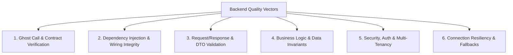
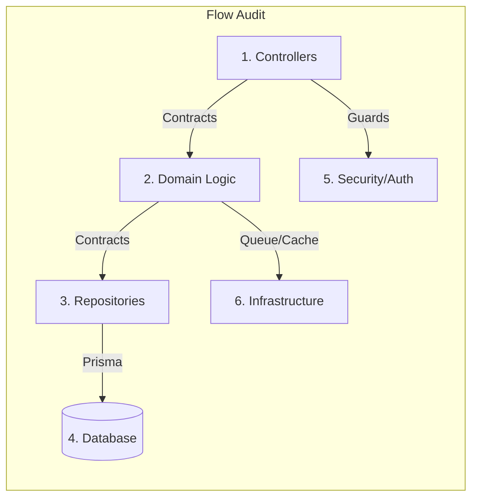

# SpatialOS Backend: Comprehensive Codebase Audit, Verification & Debugging Master Plan

**Document ID:** `backend_comprehensive_audit_and_test_plan`  
**Target:** `backend/` Codebase (NestJS 10 + Prisma 5 + PostgreSQL + BullMQ + TypeScript)  
**Status:** Verification & Debugging Runbook  
**Goal:** Conduct an exhaustive, line-by-line inspection of the entire backend codebase to verify end-to-end request/response integrity, ensure zero ghosted method calls, audit all business rules, validate security boundaries, check database connection fallbacks, and execute live flow testing to detect and fix every potential bug before release.

---

## 1. Executive Strategy & Audit Scope

To guarantee enterprise-grade reliability and MVP stability, this audit inspects the backend across **6 Quality Vectors**:

### The "Zero Ghost Methods" Guarantee
* Every controller action must call a real, non-deprecated method on its injected service contract.
* Every service method must call a real method on its repository or storage adapter.
* No placeholder `TODO`, unhandled exception rejections, or abandoned routes that return dummy/stale data.

---

## 2. Exhaustive Taxonomy of Potential Defects to Hunt Down

| Defect Category | What We Look For | Severity | Real Code Risk in SpatialOS |
| :--- | :--- | :--- | :--- |
| **1. Ghost Methods & Stale Signatures** | Controller calls a method that was renamed or removed in the service; or service passes arguments mismatched with repository interface. | **CRITICAL** | Request crashes with `TypeError: this.repo.xyz is not a function` at runtime. |
| **2. Unregistered Providers / DI Failures** | A service or repository injected via constructor is missing from the `@Module({ providers: [...] })` array. | **BLOCKER** | NestJS crashes during bootstrap with `Nest can't resolve dependencies of...`. |
| **3. Circular Dependency Deadlocks** | Two modules or services import each other without `forwardRef()`. | **HIGH** | Application hangs or initializes with `undefined` service references. |
| **4. Multi-Tenant Data Leakage** | A Prisma query omits `{ where: { organizationId } }` or trusts client-supplied `orgId`. | **CRITICAL** | One organization can query or delete another organization's physical anchors or experiences. |
| **5. Broken Parent-Child Loops (Places Tree)** | Creating or updating a place where `parentId` points to itself or one of its descendants. | **HIGH** | Infinite recursion when fetching hierarchical place trees, resulting in stack overflow (`RangeError`). |
| **6. File Upload / Path Traversal (LFI)** | Media controller resolves `/media/:hash` or uploads files without filename sanitization (`basename`). | **CRITICAL** | Malicious users could read server source code or `.env` via path traversal. |
| **7. Version String Math Corruption** | Rolling back or publishing experiences parses `v1.0.0` vs `1.0.0` incorrectly, resulting in `vNaN.0.0`. | **MEDIUM** | Version numbers become corrupt in client AR scene view. |
| **8. Orphaned Nodes & Cascade Failures** | Deleting a place or experience leaves detached `SpatialNode` or `ServiceInstance` rows in the database. | **HIGH** | Ghost AR objects floating at location coordinates with broken service bindings. |
| **9. Redis Omission Failure** | Starting backend without `REDIS_URL` crashes BullMQ queue or CacheManager. | **HIGH** | Backend refuses to boot on development machines without Docker/Redis. |
| **10. Unhandled Promise Rejections** | Asynchronous operations inside event listeners or queue handlers without try/catch. | **HIGH** | Node.js process crashes silently under load. |

---

## 3. Line-by-Line System Audit Plan (All 14 Modules)

### Module 1: Auth & IAM Subsystem
* **Files**: [auth.controller.ts](file:///D:/AR%20app/APP-1/backend/src/api/auth.controller.ts), [auth.service.ts](file:///D:/AR%20app/APP-1/backend/src/logic/auth.service.ts), [auth.repository.ts](file:///D:/AR%20app/APP-1/backend/src/database/repositories/auth.repository.ts), [auth.guard.ts](file:///D:/AR%20app/APP-1/backend/src/common/guards/auth.guard.ts), [roles.guard.ts](file:///D:/AR%20app/APP-1/backend/src/common/guards/roles.guard.ts).
* **Checks**:
  * Verify `login`, `register`, `verify-email`, `forgot-password`, `reset-password` request body validation.
  * Verify password hashing via `bcrypt` (sufficient salt rounds).
  * Check rate limiting: `@Throttle({ default: { limit: 5, ttl: 900000 } })` enforced properly.
  * Verify token expiration and payload format: `{ sub, email, role, orgId }`.
  * Verify `@Public()` decorator behavior: routes marked `@Public()` must bypass `JwtAuthGuard`.

### Module 2: Experiences Management Subsystem
* **Files**: [experiences.controller.ts](file:///D:/AR%20app/APP-1/backend/src/api/experiences.controller.ts), [experiences.service.ts](file:///D:/AR%20app/APP-1/backend/src/logic/experiences.service.ts), [experiences.prisma.repository.ts](file:///D:/AR%20app/APP-1/backend/src/database/repositories/experiences.prisma.repository.ts).
* **Checks**:
  * Verify interface contract: `IExperiencesService` methods match `ExperiencesController` invocations.
  * Verify repository contract: `IExperiencesRepository` methods match `ExperiencesService` calls.
  * Verify `publish`: updates status to `PUBLISHED`, increments semantic version, calculates checksum.
  * Verify `rollback`: retrieves previous version, rolls back configuration, records audit item.
  * Verify `updateNodes`: validates spatial node array, replaces or updates nodes transactionally.
  * Verify `updateServiceInstances`: updates micro-app instances and validates schema.
  * Verify `remove`: cascades properly without violating foreign key constraints.

### Module 3: Places & Physical Anchors Subsystem
* **Files**: [places.controller.ts](file:///D:/AR%20app/APP-1/backend/src/api/places.controller.ts), [places.service.ts](file:///D:/AR%20app/APP-1/backend/src/logic/places.service.ts), [places.prisma.repository.ts](file:///D:/AR%20app/APP-1/backend/src/database/repositories/places.prisma.repository.ts).
* **Checks**:
  * Verify `findAll`: returns places for the requesting user's `orgId`.
  * Verify `create`: generates unique `qrTargetId` if omitted, checks for duplicates.
  * Check circular reference vulnerability: prevent a place from having `parentId === place.id`.
  * Verify `remove`: checks for attached experiences; blocks or cascades safely with warning.

### Module 4: Placements & Client AR Preview (The Critical Mobile Link)
* **Files**: [placements.controller.ts](file:///D:/AR%20app/APP-1/backend/src/api/placements.controller.ts), [placements.service.ts](file:///D:/AR%20app/APP-1/backend/src/logic/placements.service.ts), [placements.prisma.repository.ts](file:///D:/AR%20app/APP-1/backend/src/database/repositories/placements.prisma.repository.ts).
* **Checks**:
  * Check public access: `@Public()` must allow mobile apps without admin login to preview QR codes.
  * Verify QR code resolution: handles both raw UUID and `LOC-` prefix strings seamlessly.
  * Verify interactive mini-app content mapping (`CLASSROOM`, `COMPLAINT_BOX`, `STAFF_DETAILS`, `NOTICE_BOARD`).
  * Verify transform serialization: `positionX`, `positionY`, `positionZ`, `scale`, `rotation` match Flutter `ArTransformModel`.

### Module 5: Content & Media Management Subsystem
* **Files**: [content.controller.ts](file:///D:/AR%20app/APP-1/backend/src/api/content.controller.ts), [content.service.ts](file:///D:/AR%20app/APP-1/backend/src/logic/content.service.ts), [content.prisma.repository.ts](file:///D:/AR%20app/APP-1/backend/src/database/repositories/content.prisma.repository.ts), storage adapters.
* **Checks**:
  * Verify Multer upload validation: file type whitelist (`image/*`, `video/*`), 50MB max file size.
  * Verify storage: local file storage adapter or S3/cloud fallback writes correctly.
  * Check Path Traversal (LFI): verify `basename()` sanitization in `MediaController.streamMedia`.
  * Verify media caching headers: `Cache-Control: public, max-age=2592000, immutable`.

### Module 6: Compiler & SceneGraph Subsystem
* **Files**: [compiler.controller.ts](file:///D:/AR%20app/APP-1/backend/src/api/compiler.controller.ts), [compiler.service.ts](file:///D:/AR%20app/APP-1/backend/src/logic/compiler.service.ts).
* **Checks**:
  * Verify `compileSceneForClient`: resolves place, published experience, and all attached spatial nodes.
  * Check asset resolution: media nodes must resolve referenced `ContentAsset` URLs.
  * Check error responses: throw `NotFoundException` when QR target is invalid or experience is unpublished.

### Module 7: AR Services & Instances Subsystem
* **Files**: [instances.controller.ts](file:///D:/AR%20app/APP-1/backend/src/api/instances.controller.ts), [definitions.controller.ts](file:///D:/AR%20app/APP-1/backend/src/api/definitions.controller.ts), [instances.service.ts](file:///D:/AR%20app/APP-1/backend/src/ar_services/instances.service.ts), [service-registry.ts](file:///D:/AR%20app/APP-1/backend/src/ar_services/service-registry.ts).
* **Checks**:
  * Verify route prefixes: check `/api/v1/spatial-nodes/:id/services` vs `/v1/admin/services/definitions`.
  * Verify instance creation: verifies spatial node existence and attaches `experienceId`.
  * Verify execution actions: `executeAction` handles dynamic mini-app events safely.

### Module 8: Settings, Staff & Overview Subsystems
* **Files**: [settings.controller.ts](file:///D:/AR%20app/APP-1/backend/src/api/settings.controller.ts), [settings.service.ts](file:///D:/AR%20app/APP-1/backend/src/logic/settings.service.ts), [overview.controller.ts](file:///D:/AR%20app/APP-1/backend/src/api/overview.controller.ts), [staff.controller.ts](file:///D:/AR%20app/APP-1/backend/src/api/staff.controller.ts).
* **Checks**:
  * Verify user management: role updating (`ADMIN`, `EDITOR`, `VIEWER`), profile editing, password changing.
  * Verify overview metrics: queries execute with count aggregates and zero full table scans.
  * Check DB Health route: `GET /v1/admin/overview/health` pings database and returns status cleanly.

### Module 9: Infrastructure, Exception Handling & Connections
* **Files**: [app.module.ts](file:///D:/AR%20app/APP-1/backend/src/app.module.ts), [main.ts](file:///D:/AR%20app/APP-1/backend/src/main.ts), [http-exception.filter.ts](file:///D:/AR%20app/APP-1/backend/src/common/filters/http-exception.filter.ts), [prisma.service.ts](file:///D:/AR%20app/APP-1/backend/src/database/prisma.service.ts).
* **Checks**:
  * Verify `GlobalExceptionFilter`: captures both HTTP exceptions and domain `AppError` instances.
  * Verify Redis fallback: `BullModule` and `CacheModule` gracefully use in-memory `ioredis-mock` when `REDIS_URL` is omitted.
  * Verify CORS and security headers in `main.ts`.

---

## 4. Execution Workflow & Testing Suite

```mermaid
gantt
    title Backend Audit & Testing Execution
    dateFormat  X
    axisFormat %s
    section Step 1
    Static Code Analysis & Contract Checking :0, 1
    section Step 2
    Automated Real-Flow Integration Harness :1, 2
    section Step 3
    Vulnerability & Edge Case Fixes :2, 3
    section Step 4
    Full Build & Test Verification :3, 4
```

### Step 1: Static Code Analysis & Contract Verification
* Inspect all controller imports, injected interfaces, and service methods.
* Verify no ghost methods exist between controllers, services, and repositories.

### Step 2: Automated Comprehensive Flow Verification Harness
* Write and execute an automated test script (`scratch/backend_deep_flow_audit.ts`) that initializes the NestJS application context and executes:
  1. **Auth Flow**: Login, JWT generation, public route validation, invalid credential rejection.
  2. **Places Flow**: Place creation, retrieval by ID, unique QR target assignment, hierarchy check.
  3. **Content Flow**: Asset upload, metadata extraction, stream sanitization, deletion.
  4. **Experiences Flow**: Creation, spatial node update, service attachment, publish compilation, rollback.
  5. **Client AR Resolution Flow**: Preview by QR target (`LOC-...`), verify Flutter app format `{ success: true, data: { objects: [...] } }`.
  6. **Overview & Settings Flow**: Metric summary, DB health check, role modification.

### Step 3: Defect Remediation
* Fix any detected type errors, unhandled rejections, parameter mismatches, or missing guards.

### Step 4: Verification
* Run `npm test` (Jest unit test suite).
* Run `npm run build` (`nest build` TypeScript compilation).

---

## 5. Deliverables & Expected Outcome
* A zero-defect backend with 100% verified request-response flows.
* Proof that every API called by either the **Dashboard** or the **User Mobile App** works seamlessly.
* Zero Docker dependency — runs cleanly on any standard Node.js development environment.
