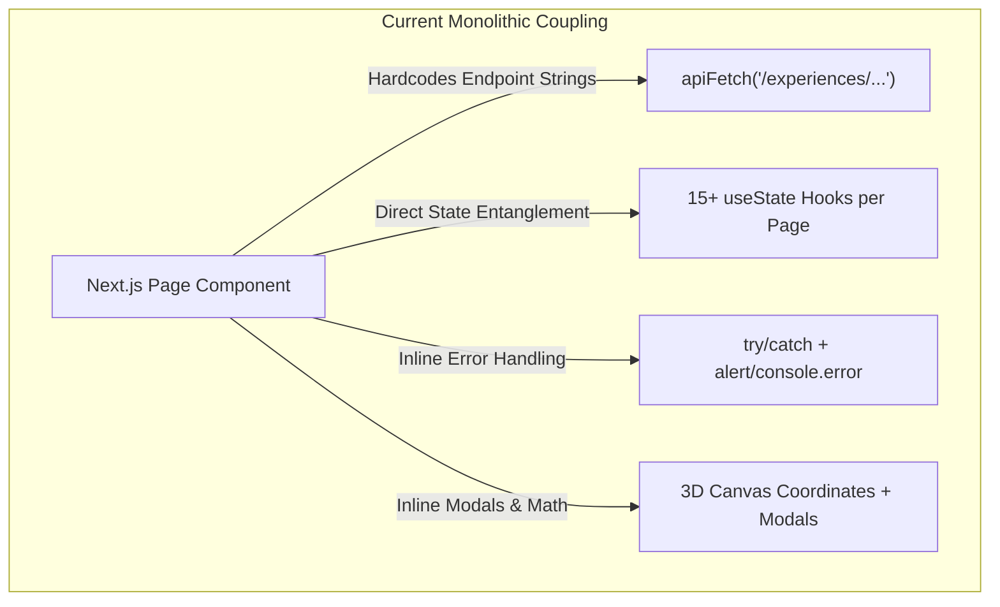

# SpatialOS Dashboard Layer-by-Layer Architecture & Abstraction Master Plan

**Document ID:** `dashboard_layer_by_layer_architecture_plan`  
**Target:** `dashboard/` Codebase (Next.js 16 + React + Tailwind CSS)  
**Status:** Architecture Proposal & Implementation Runbook  
**Goal:** Transform the dashboard from monolithic, all-in-one page components into a clean 5-layer, contract-abstracted enterprise architecture. Separate UI presentation from state management and network transport, deconstruct the 1,647-line God Object in `experiences/[id]/page.tsx`, and make every defect immediately traceable to its exact layer and source file.

---

## 1. Executive Summary & Core Philosophy

### The "Black Box" Frontend Contract Principle
In modern frontend architecture, **a page or visual component should never know how data is transported, what HTTP endpoints exist, or how errors are parsed**:
1. **Contract-Driven**: Visual UI components consume data and action triggers purely through **Feature Custom Hooks (View-Models)** and **Client Service Contracts**.
2. **Encapsulation**: State machines (active tabs, node dragging, form dirty tracking, modal visibility) are encapsulated within custom hooks; network transport (headers, JWT tokens, endpoints) is isolated within domain services and the HTTP client.
3. **Layer Traceability**: If an operation fails, the error explicitly tags its **Layer Origin** (`UI`, `HOOK_STATE`, `SERVICE_CLIENT`, `HTTP_TRANSPORT`), ensuring zero ambiguity about where a bug occurred.
4. **Predictable Result Container**: API interactions return a typed `Result<T, DashboardError>` rather than throwing unhandled runtime exceptions that crash the React rendering tree.

---

## 2. Current State Inventory (Real Codebase Audit)

An audit of `dashboard/src` reveals a typical early-stage Next.js structure that has accumulated significant architectural debt:

### 2.1 File & Directory Inventory
* **Pages (`src/app/` - 11 routes):**
  * `experiences/page.tsx` (224 lines)
  * `experiences/[id]/page.tsx` (**1,647 lines / 90 KB - Massive God Object**)
  * `experiences/create/page.tsx` (160 lines)
  * `places/page.tsx` (474 lines)
  * `places/[id]/page.tsx` (180 lines)
  * `places/create/page.tsx` (140 lines)
  * `content/page.tsx` (272 lines)
  * `login/page.tsx` (190 lines)
  * `monitoring/page.tsx`, `publishing/page.tsx`, `services/page.tsx`, `settings/page.tsx`, `users/page.tsx`.
* **Components (`src/components/` - 10 top-level files + 3 subfolders):**
  * Top-level: `AppLayout.tsx`, `DashboardHeader.tsx`, `NodeInspector.tsx`, `OverviewCards.tsx`, `OverviewWidgets.tsx`, `Sidebar.tsx`, `ThemeProvider.tsx`, `ThemeToggle.tsx`, `TopNav.tsx` (500+ lines), `VisualEditor.tsx`.
  * Subdirectories: `map/`, `services/` (`ClassroomEditor`, `NoticeBoardEditor`, `ComplaintBoxEditor`, `StaffDetailsEditor`), `shared/` (`ContentPickerModal`).
* **Library Layer (`src/lib/` - ONLY 1 file):**
  * `api.ts` (46 lines): A bare-bones `fetch` wrapper.
* **State Management (`src/store/` - ONLY 1 file):**
  * `useBuilderStore.ts` (48 lines): Zustand store with minimal spatial node state.
* **Types (`src/types/` - ONLY 1 file):**
  * `api.ts` (114 lines): Direct backend data interfaces.
* **Service Abstraction Layer (`src/services/`):**
  * **0 files (Does not exist).**

---

### 2.2 Critical Architectural Debt & Layer-Crossing Flaws



1. **The 1,647-Line "God Object" (`experiences/[id]/page.tsx`)**:
   Contains everything in a single file:
   * 6 major tabs (Overview, Content, Services, Spatial Canvas, Configuration, Publishing).
   * QR code rendering math.
   * 3D spatial node coordinate transformations and canvas drag-and-drop.
   * Service instance configuration editing.
   * Direct `apiFetch` network calls scattered throughout.
   * 20+ separate `useState` hooks causing cascading re-renders.
2. **Missing Service Abstraction Layer**:
   Pages hardcode string endpoints (`apiFetch('/experiences')`, `apiFetch('/places')`, `apiFetch('/content/upload')`). If a backend URL or payload contract changes, developers must hunt through dozens of `.tsx` files.
3. **No Feature Custom Hooks (View-Models)**:
   Every page independently reinvents the wheel for data fetching:
   ```typescript
   const [data, setData] = useState([]);
   const [isLoading, setIsLoading] = useState(true);
   useEffect(() => { fetch(); }, []);
   ```
   This duplicates boilerplate across 11 pages with zero reusability or isolated testability.
4. **Fragile Error Handling**:
   Errors are caught with generic `catch (err)` and dumped into `console.error` or temporary string state. There is no structured error categorization (network offline vs. validation error vs. unauthorized).
5. **Coupled Auth Redirection**:
   `api.ts` forces `window.location.href = '/login'` directly on any 401 response, bypassing Next.js client-side router transitions.

---

## 3. The 5-Layer Encapsulated Clean Architecture Model for Next.js

```mermaid
graph TB
    subgraph Layer 1: Presentation & UI Component Layer
        PAGE_ROUTES[Page Routes: /experiences, /places, /content]
        UI_VIEWS[View Components: Tables, Cards, Modals, Forms]
        CANVAS_VIEW[Spatial Canvas View & Node Renderers]
    end

    subgraph Layer 2: Feature Custom Hooks & View-Models
        HOOK_EXP[useExperiences / useExperienceDetails]
        HOOK_EDITOR[useExperienceEditor - State Machine]
        HOOK_PLACES[usePlaces / usePlaceDetails]
        HOOK_CONTENT[useContentAssets / useFileUpload]
    end

    subgraph Layer 3: Domain Service Abstraction Layer
        SRV_CONTRACTS[Client Service Contracts: IExperiencesService, etc.]
        SRV_EXP[ExperiencesClientService]
        SRV_PLACES[PlacesClientService]
        SRV_CONTENT[ContentClientService]
        SRV_AUTH[AuthClientService]
    end

    subgraph Layer 4: HTTP Transport & Client Engine
        HTTP_CLIENT[HttpClient: get, post, put, delete, upload]
        INTERCEPTORS[Auth Header Interceptor & Error Normalizer]
    end

    subgraph Layer 5: Domain Models, Types & Result Containers
        RESULT[Result Container: Result&lt;T, DashboardError&gt;]
        MODELS[Domain Models: Experience, Place, SpatialNode]
        DTO[API Request & Response DTOs]
    end

    PAGE_ROUTES -->|Consumes State & Actions| HOOK_EXP
    PAGE_ROUTES -->|Consumes Editor State Machine| HOOK_EDITOR
    HOOK_EXP -->|Calls via Service Contract| SRV_CONTRACTS
    SRV_CONTRACTS -.->|Implemented by| SRV_EXP
    SRV_EXP -->|Executes HTTP Requests| HTTP_CLIENT
    HTTP_CLIENT -->|Normalizes Responses into| RESULT
    RESULT -->|Uses| MODELS
```

---

### Detailed Layer Responsibilities & Boundaries

| Layer | Component Name | What it Holds | What it is FORBIDDEN to do |
| :--- | :--- | :--- | :--- |
| **Layer 1** | **Presentation & UI Components** | JSX markup, Tailwind styling, buttons, input fields, visual tabs, layout grids. | **NO `fetch()` or `apiFetch()` calls**. **NO complex business math**. Only renders props and invokes hook callbacks. |
| **Layer 2** | **Feature Custom Hooks (View-Models)** | React state machines, filtering/sorting logic, form state, editor selections, modal toggles. | **NO direct `fetch` calls**. Must delegate all network operations to Layer 3 Services. |
| **Layer 3** | **Domain Service Abstraction** | Client API service classes (`ExperiencesService`, `PlacesService`). Encapsulates endpoints, query params, and DTO mappings. | **NO React hooks** (`useState`, `useEffect`). Pure TypeScript classes returning typed `Result<T>`. |
| **Layer 4** | **HTTP Transport Engine** | `HttpClient` singleton, JWT token injection, timeout handling, error normalization. | **NO domain-specific logic**. Operates strictly on generic HTTP semantics. |
| **Layer 5** | **Domain Models & Result Contracts** | TypeScript interfaces (`Experience`, `Place`), DTO types, `Result<T, DashboardError>`, `DashboardError`. | **Zero runtime logic** (pure type contracts and immutable result containers). |

---

## 4. Contract Abstractions & Result Container Specification

### 4.1 Layer-Tagged Error Traceability
```typescript
// src/core/errors/dashboard-error.ts

export type DashboardLayerOrigin = 'UI' | 'HOOK_STATE' | 'SERVICE_CLIENT' | 'HTTP_TRANSPORT';

export class DashboardError extends Error {
  constructor(
    public readonly layer: DashboardLayerOrigin,
    public readonly code: string,
    public readonly message: string,
    public readonly status?: number,
    public readonly details?: Record<string, any>,
    public readonly sourceFile?: string,
  ) {
    super(message);
    this.name = 'DashboardError';
  }

  static http(code: string, message: string, status?: number, details?: any): DashboardError {
    return new DashboardError('HTTP_TRANSPORT', code, message, status, details, 'http-client.ts');
  }

  static service(code: string, message: string, sourceFile: string, details?: any): DashboardError {
    return new DashboardError('SERVICE_CLIENT', code, message, undefined, details, sourceFile);
  }

  static hook(code: string, message: string, sourceFile: string, details?: any): DashboardError {
    return new DashboardError('HOOK_STATE', code, message, undefined, details, sourceFile);
  }
}
```

---

### 4.2 The Frontend Result Container
```typescript
// src/core/results/result.ts
import { DashboardError } from '../errors/dashboard-error';

export type Result<T, E = DashboardError> =
  | { readonly ok: true; readonly value: T; readonly error?: never }
  | { readonly ok: false; readonly value?: never; readonly error: E };

export const Result = {
  ok<T>(value: T): Result<T, never> {
    return { ok: true, value };
  },
  fail<E = DashboardError>(error: E): Result<never, E> {
    return { ok: false, error };
  },
};
```

---

### 4.3 Service Contract Definition: `IExperiencesClientService`
```typescript
// src/services/contracts/experiences-client.interface.ts
import { Result } from '../../core/results/result';
import { Experience, CreateExperienceDto, UpdateExperienceDto } from '../../types/api';

export interface IExperiencesClientService {
  getAll(): Promise<Result<Experience[]>>;
  getById(id: string): Promise<Result<Experience>>;
  create(dto: CreateExperienceDto): Promise<Result<Experience>>;
  update(id: string, dto: UpdateExperienceDto): Promise<Result<Experience>>;
  publish(id: string): Promise<Result<Experience>>;
  rollback(id: string): Promise<Result<Experience>>;
  updateNodes(id: string, nodes: any[]): Promise<Result<void>>;
  updateServiceInstances(id: string, instances: any[]): Promise<Result<void>>;
  delete(id: string): Promise<Result<void>>;
}
```

---

## 5. Before vs. After Concrete Code Comparison

### 5.1 Fetching Experiences: Before vs. After

#### [BEFORE] Monolithic Page Component (`src/app/experiences/page.tsx` - 224 lines):
```tsx
// OLD: Everything crammed into the page component
export default function ExperiencesPage() {
  const [experiences, setExperiences] = useState<Experience[]>([]);
  const [isLoading, setIsLoading] = useState(true);

  const fetchExperiences = async () => {
    setIsLoading(true);
    try {
      const data = await apiFetch<Experience[]>('/experiences'); // Hardcoded endpoint!
      setExperiences(data);
    } catch (error) {
      console.error('Failed to fetch experiences:', error);
    } finally {
      setIsLoading(false);
    }
  };

  useEffect(() => { fetchExperiences(); }, []);
  // ... 180+ lines of inline JSX, filter inputs, and table rows
}
```

#### [AFTER] Decoupled into Clean Layers:

**Layer 3: Client Service (`src/services/experiences.service.ts`):**
```typescript
export class ExperiencesClientService implements IExperiencesClientService {
  constructor(private readonly http: IHttpClient) {}

  async getAll(): Promise<Result<Experience[]>> {
    return this.http.get<Experience[]>('/experiences');
  }

  async getById(id: string): Promise<Result<Experience>> {
    return this.http.get<Experience>(`/experiences/${id}`);
  }

  async publish(id: string): Promise<Result<Experience>> {
    return this.http.post<Experience>(`/experiences/${id}/publish`);
  }
}
export const experiencesService = new ExperiencesClientService(httpClient);
```

**Layer 2: Feature Custom Hook (`src/hooks/useExperiences.ts`):**
```typescript
export function useExperiences() {
  const [experiences, setExperiences] = useState<Experience[]>([]);
  const [isLoading, setIsLoading] = useState(true);
  const [error, setError] = useState<string | null>(null);
  const [searchQuery, setSearchQuery] = useState('');

  const loadExperiences = useCallback(async () => {
    setIsLoading(true);
    setError(null);
    const result = await experiencesService.getAll();
    if (result.ok) {
      setExperiences(result.value);
    } else {
      setError(result.error.message);
    }
    setIsLoading(false);
  }, []);

  useEffect(() => { loadExperiences(); }, [loadExperiences]);

  const filteredExperiences = useMemo(() => {
    return experiences.filter(exp => 
      exp.name.toLowerCase().includes(searchQuery.toLowerCase())
    );
  }, [experiences, searchQuery]);

  return {
    experiences: filteredExperiences,
    rawExperiences: experiences,
    isLoading,
    error,
    searchQuery,
    setSearchQuery,
    refresh: loadExperiences,
  };
}
```

**Layer 1: Declarative Page Component (`src/app/experiences/page.tsx` - Reduced to ~50 lines):**
```tsx
export default function ExperiencesPage() {
  const { experiences, isLoading, error, searchQuery, setSearchQuery, refresh } = useExperiences();

  if (isLoading) return <ExperiencesTableSkeleton />;
  if (error) return <ErrorMessage message={error} onRetry={refresh} />;

  return (
    <div className="p-8 max-w-7xl mx-auto">
      <ExperiencesHeader onRefresh={refresh} />
      <ExperiencesToolbar searchQuery={searchQuery} onSearchChange={setSearchQuery} />
      <ExperiencesTable experiences={experiences} onRefresh={refresh} />
    </div>
  );
}
```

---

## 6. Deconstruction of the 1,647-Line God Object

`dashboard/src/app/experiences/[id]/page.tsx` will be deconstructed into a **Single Custom Hook (View-Model)** and **6 Focused Tab Components**:

```
src/app/experiences/[id]/
├── page.tsx                           # Reduced from 1,647 lines to ~80 lines!
│
├── hooks/
│   └── useExperienceEditor.ts         # Encapsulates all 20+ useStates, tabs, and mutations
│
└── components/
    ├── ExperienceHeader.tsx           # Title, Back button, Status badge, Save button
    ├── ExperienceTabNav.tsx           # The 6 tab navigation pills
    ├── tabs/
    │   ├── OverviewTab.tsx            # Place linkage, description, schedule
    │   ├── ContentTab.tsx             # Media attachments, image/video pickers
    │   ├── ServicesTab.tsx            # Micro-App service instance cards & editors
    │   ├── SpatialCanvasTab.tsx       # 3D canvas, coordinate dragging, transforms
    │   ├── ConfigurationTab.tsx       # JSON schema & environment settings
    │   └── PublishingTab.tsx          # Release queue, version history, rollback
    └── modals/
        └── ExperienceQrModal.tsx      # QR code generation & download
```

### Result of God Object Deconstruction:
* **`page.tsx`**: Becomes purely a layout shell:
  ```tsx
  export default function ExperienceDetailsPage() {
    const editor = useExperienceEditor();

    if (editor.isLoading) return <EditorSkeleton />;

    return (
      <div className="flex flex-col h-screen bg-slate-900 text-white">
        <ExperienceHeader editor={editor} />
        <ExperienceTabNav activeTab={editor.activeTab} onSelectTab={editor.setActiveTab} />
        <div className="flex-1 overflow-y-auto">
          {editor.activeTab === 'overview' && <OverviewTab editor={editor} />}
          {editor.activeTab === 'content' && <ContentTab editor={editor} />}
          {editor.activeTab === 'services' && <ServicesTab editor={editor} />}
          {editor.activeTab === 'spatial' && <SpatialCanvasTab editor={editor} />}
          {editor.activeTab === 'configuration' && <ConfigurationTab editor={editor} />}
          {editor.activeTab === 'publishing' && <PublishingTab editor={editor} />}
        </div>
      </div>
    );
  }
  ```

---

## 7. Target Folder Structure (After Re-organization)

```
dashboard/src/
├── app/                               # Layer 1: Next.js App Router Page Shells
│   ├── experiences/
│   │   ├── page.tsx                   # Lightweight (~50 lines)
│   │   └── [id]/
│   │       ├── page.tsx               # Orchestrator (~80 lines)
│   │       ├── hooks/                 # Feature-scoped hook
│   │       │   └── useExperienceEditor.ts
│   │       └── components/            # Feature-scoped tab components
│   │           ├── tabs/
│   │           └── modals/
│   ├── places/
│   │   ├── page.tsx                   # Lightweight (~60 lines)
│   │   └── [id]/page.tsx
│   ├── content/page.tsx               # Lightweight (~50 lines)
│   └── ...
│
├── components/                        # Layer 1: Reusable Presentation Components
│   ├── layout/
│   │   ├── AppLayout.tsx
│   │   ├── Sidebar.tsx
│   │   └── TopNav.tsx
│   ├── ui/                            # Atoms: Buttons, Inputs, Modals, Badges
│   │   ├── Button.tsx
│   │   ├── Input.tsx
│   │   ├── Modal.tsx
│   │   └── Badge.tsx
│   └── shared/
│       ├── ContentPickerModal.tsx
│       └── ErrorBanner.tsx
│
├── hooks/                             # Layer 2: Feature Custom Hooks / View-Models
│   ├── useExperiences.ts              # Listing & filtering state
│   ├── usePlaces.ts                   # Places listing & filtering state
│   ├── useContentAssets.ts            # Media assets & upload progress state
│   ├── useAuth.ts                     # Login, session, token state
│   └── useToast.ts                    # Notification state
│
├── services/                          # Layer 3: Domain Client Services
│   ├── contracts/                     # TypeScript Interfaces
│   │   ├── experiences-client.interface.ts
│   │   ├── places-client.interface.ts
│   │   ├── content-client.interface.ts
│   │   └── auth-client.interface.ts
│   ├── experiences.service.ts         # Concrete client implementation
│   ├── places.service.ts              # Concrete client implementation
│   ├── content.service.ts             # Concrete client implementation
│   └── auth.service.ts                # Concrete client implementation
│
├── core/                              # Layer 4 & 5: Foundations & HTTP Engine
│   ├── http/
│   │   ├── http-client.ts             # Generic fetch client with interceptors
│   │   └── http-client.interface.ts
│   ├── errors/
│   │   └── dashboard-error.ts         # Layer-tagged error class
│   └── results/
│       └── result.ts                  # Typed Result<T, DashboardError>
│
└── types/                             # Pure Domain Types & DTOs
    └── api.ts                         # Models: Experience, Place, SpatialNode
```

---

## 8. Step-by-Step Implementation Execution Plan

The execution is organized into 6 safe, incremental phases to ensure zero regressions and continuous build success:

```mermaid
gantt
    title Dashboard Layer-by-Layer Architecture Execution
    dateFormat  X
    axisFormat %s
    section Phase 1
    Core HTTP Engine, DashboardError & Result Container :0, 1
    section Phase 2
    Domain Client Services & Interfaces :1, 2
    section Phase 3
    Feature Custom Hooks (useExperiences, usePlaces, useContent) :2, 3
    section Phase 4
    Standard CRUD Pages Refactor (experiences, places, content) :3, 4
    section Phase 5
    Deconstruct 1,647-Line God Object (experiences/[id]) :4, 5
    section Phase 6
    Next.js Turbopack Build & Verification :5, 6
```



### Phase 1: Core Foundation & HTTP Engine (Layers 4 & 5)
* Create `src/core/errors/dashboard-error.ts` with layer tags (`UI`, `HOOK_STATE`, `SERVICE_CLIENT`, `HTTP_TRANSPORT`).
* Create `src/core/results/result.ts` with `Result.ok()` and `Result.fail()`.
* Create `src/core/http/http-client.ts` implementing `IHttpClient`:
  * Automatic Bearer token attachment from `localStorage`.
  * Safe error unmarshaling into `DashboardError`.
  * Clean response serialization.

### Phase 2: Domain Client Services (Layer 3)
* Define service interfaces in `src/services/contracts/`:
  * `experiences-client.interface.ts`
  * `places-client.interface.ts`
  * `content-client.interface.ts`
  * `auth-client.interface.ts`
* Implement client services in `src/services/`:
  * `experiences.service.ts`
  * `places.service.ts`
  * `content.service.ts`
  * `auth.service.ts`

### Phase 3: Feature Custom Hooks / View-Models (Layer 2)
* Create `src/hooks/useExperiences.ts` (encapsulates loading, filtering, search, refresh).
* Create `src/hooks/usePlaces.ts` (encapsulates tab filtering, modal drawers, deletion).
* Create `src/hooks/useContentAssets.ts` (encapsulates file uploads, progress, asset deletion).

### Phase 4: Standard CRUD Page Refactoring (Layer 1)
* Refactor `src/app/experiences/page.tsx` to consume `useExperiences()`.
* Refactor `src/app/places/page.tsx` to consume `usePlaces()`.
* Refactor `src/app/content/page.tsx` to consume `useContentAssets()`.

### Phase 5: Deconstruct the 1,647-Line God Object (Layer 1 & 2)
* Extract state machine and editor actions into `src/app/experiences/[id]/hooks/useExperienceEditor.ts`.
* Extract the 6 tabs into separate components under `src/app/experiences/[id]/components/tabs/`.
* Reduce `src/app/experiences/[id]/page.tsx` to a clean, declarative ~80-line shell.

### Phase 6: Automated Verification & Build Check
* Run `npm run build` on `dashboard` (Next.js Turbopack compilation check).
* Verify routing, token authorization, and 3D canvas interaction.

---

## 9. Summary of Benefits for MVP and Long-Term Scalability

1. **Instant Defect Localization**: When something fails on the dashboard, the console and UI error state explicitly declare:
   `[DashboardError: SERVICE_CLIENT:EXPERIENCE_FETCH_FAILED at experiences.service.ts]` or
   `[DashboardError: HTTP_TRANSPORT:NETWORK_TIMEOUT (504) at http-client.ts]`.
2. **Deconstruction of 1,647-Line Monolith**: The single largest source of cognitive overload and regression risk in the frontend is eliminated.
3. **Zero Coupling to Endpoint Paths**: If the backend API route changes from `/v1/admin/experiences` to `/api/v2/experiences`, exactly **one line of code** changes in `experiences.service.ts`. Not a single React page or component is affected.
4. **Effortless Unit & Component Testing**: Hooks and components can be tested in isolation with simple mock services without needing network mocking.
